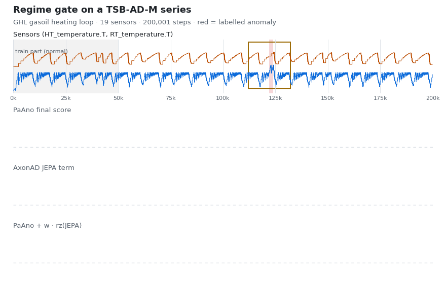
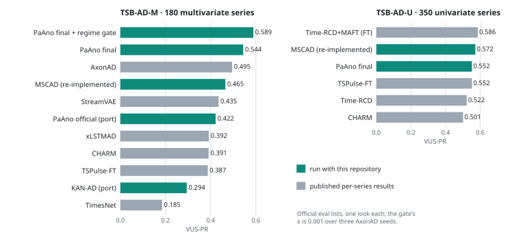
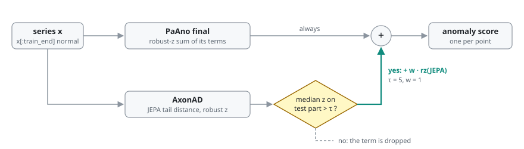
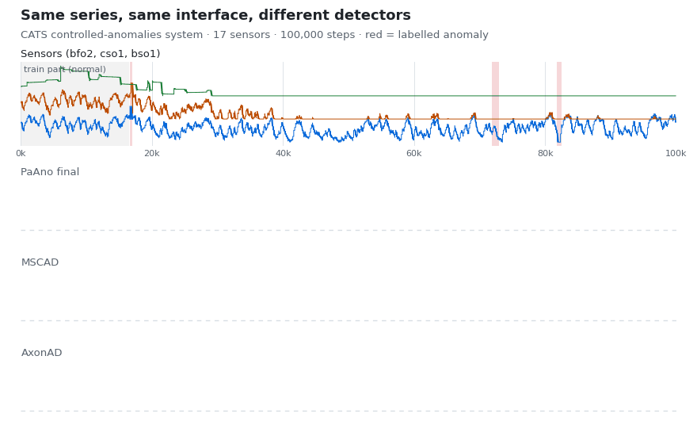

<div align="center">

# industrial-tsad

**Time-series analysis and anomaly detection for industrial data**

Recent detectors behind one interface · label-free score fusion · a reproducible benchmark protocol on TSB-AD

[](#quick-start)
[](#quick-start)
[](https://github.com/TheDatumOrg/TSB-AD)
[](#detectors)
[](LICENSE)

[Results](#results) · [How it works](#how-it-works) · [Protocol](#evaluation-protocol) · [Quick start](#quick-start) · [Detectors](#detectors)

</div>

<picture>
  <source media="(prefers-color-scheme: dark)" srcset="docs/assets/gate-demo-dark.gif">
  
</picture>

<sub>A TSB-AD-M series from a gasoil heating loop (19 sensors, 200k steps). PaAno alone misses the labelled fault;
AxonAD's JEPA term reports a regime change, so the gate adds it and the fault stands out. Scores come from saved runs
and are only revealed by the animation (`scripts/make_readme_animation.py`).</sub>

Industrial signals (sensor and process streams, inspection profiles) rarely come with enough labels to tune on. Every
method here is therefore chosen on a separate tuning list and judged **once** on held-out series, with paired bootstrap
intervals and rules registered before the result exists. The public [TSB-AD](https://github.com/TheDatumOrg/TSB-AD)
benchmark is the reference for each change before it is used on plant data.

## Results

<picture>
  <source media="(prefers-color-scheme: dark)" srcset="docs/assets/results-dark.svg">
  
</picture>

| VUS-PR | TSB-AD-M · 180 series | TSB-AD-U · 350 series |
|---|:---:|:---:|
| **PaAno final + regime gate** | **0.589 ± 0.001** | — |
| PaAno final (`paano_final`) | 0.544 ± 0.001 | 0.552 |
| MSCAD, our re-implementation (`mscad`) | 0.465 | **0.572** |
| Best published per-series result | 0.495 (AxonAD) | 0.552 (TSPulse-FT) |

- **Regime gate.** AxonAD's JEPA term is added only on series whose test-part median exceeds τ = 5. That gives
  +0.093 to +0.095 over the published AxonAD, with series and dataset-cluster intervals above zero for every AxonAD seed.
- **Univariate.** MSCAD − PaAno = +0.020 (95 % CI −0.015 … +0.057, not significant). On 472 further univariate series
  PaAno leads, 0.407 vs 0.320.
- **Negative results are kept.** Mode-token adapters and score fusion did not pass the protocol; see
  [docs/results_tsbad.md](docs/results_tsbad.md).

## How it works

<picture>
  <source media="(prefers-color-scheme: dark)" srcset="docs/assets/architecture-dark.svg">
  
</picture>

A run takes a **preset** (YAML → strict pydantic config) and an official **file list**. For each series the detector
trains on the normal prefix `x[:train_end]` and returns one score per point. VUS-PR is computed per series, and
metrics, scores and score parts are saved under `results/`. Third-party code (TSB-AD's metric and models, CATCH,
KAN-AD) is imported from local clones at run time and is never copied into the repository.

Interactive versions with pan, zoom, search and path tracing:
[architecture](docs/diagrams/architecture.html) · [protocol](docs/diagrams/protocol.html). Download them and open in
a browser.

### Regime gate

The best TSB-AD-M system adds a second detector's view only when that detector reports a regime change on the series:

<picture>
  <source media="(prefers-color-scheme: dark)" srcset="docs/assets/gate-dark.svg">
  
</picture>

τ = 5 and w = 1 were chosen on the 20 tuning series, inside a wide gap of the statistic
(`industrial_tsad.core.fusion.RegimeGate`).

## Evaluation protocol

<picture>
  <source media="(prefers-color-scheme: dark)" srcset="docs/assets/protocol-dark.svg">
  
</picture>

| step | rule |
|---|---|
| Select on the tuning list | 20 (M) / 48 (U) series. A variant must move more datasets up than down at \|d\| > 0.01 and drop no dataset by more than 0.05. |
| Pre-register | question, selection rule, claim rule and the SHA-256 of the code are written before the eval run (`local/prereg.py`). Records are appended, never overwritten. |
| Evaluate once | 180 (M) / 350 (U) eval series, per-series seeds, paired with the baseline on the same series. |
| Claim | gain ≥ +0.008 VUS-PR and a series-bootstrap 95 % interval above zero (Bonferroni over looks). Dataset-cluster intervals are reported too. |

Details: [docs/protocol.md](docs/protocol.md).

## Quick start

```bash
git clone https://github.com/CVKim/industrial-tsad.git
cd industrial-tsad
pip install -e ".[dev]"
python -m pytest            # CPU only, no data needed
```

Data and third-party code stay outside the repository. Point to them with environment variables or with a git-ignored
`paths.local.json` at the repository root (copy `paths.local.example.json`):

| variable | content |
|---|---|
| `ITSAD_TSBAD_DATA` | folder with `TSB-AD-M/` and `TSB-AD-U/` (https://www.thedatum.org/datasets/TSB-AD-M.zip, `TSB-AD-U.zip`) |
| `ITSAD_TSBAD_CODE` | clone of [AxonAD](https://github.com/iis-esslingen/AxonAD): the TSB_AD package, official file lists and published results |
| `ITSAD_CATCH_CODE` | clone of [CATCH](https://github.com/decisionintelligence/CATCH), only for `catch` |
| `ITSAD_KANAD_CODE` | clone of [KAN-AD](https://github.com/issaccv/KAN-AD), only for `kanad` |
| `ITSAD_RESULTS` | output folder, default `results/` |

`published:<Method>` reads per-series results from the clone's `benchmark_exp/`. AxonAD and StreamVAE are not in the
clone: copy `Multi_AxonAD.csv` and `Multi_StreamVAE.csv` from the
[TSB-AD leaderboard](https://github.com/TheDatumOrg/TSB-AD/tree/main/benchmark_exp/leaderboard_results) into
`<TSB-AD data>/leaderboard_results/`.

```bash
# one detector over an official list; start the same command in more processes to share the run
python local/run_benchmark.py --preset paano_final --benchmark M --list TSB-AD-M-Eva.csv --tag paano_final_eva

# paired comparison with another run or a published method
python local/compare.py --a results/tsbad_M/paano_final_eva --b published:AxonAD --benchmark M

# regime gate on top of a saved AxonAD run (saved with its score parts)
python local/gate.py --base results/tsbad_M/paano_final_eva --axonad results/tsbad_M/axonad_eva \
    --list TSB-AD-M-Eva.csv --out results/tsbad_M/gate.json
```

```python
from industrial_tsad import create_detector
from industrial_tsad.datasets import load

s = load("002_MSL_id_1_Sensor_tr_500_1st_900.csv", "M")
det = create_detector("paano_final")                 # preset name, YAML path, dict or config object
score = det.fit_score(s.x, s.train_end, seed=2028)   # one anomaly score per point
```

## Detectors

<picture>
  <source media="(prefers-color-scheme: dark)" srcset="docs/assets/tour-dark.gif">
  
</picture>

<sub>One TSB-AD-M series (CATS, 17 sensors) scored by three detectors through the same `fit_score` call. PaAno final
finds all three labelled anomalies, MSCAD follows a slow drift, and AxonAD sees only the first one.</sub>

| `type` | method | in this repository | presets |
|---|---|---|---|
| `paano` | PaAno (ICLR 2026): patch embeddings, k-means memory bank, kNN distance | port (MIT); `final` adds three terms | `paano_official` `paano_final` |
| `mscad` | MSCAD (arXiv 2609.38004): multi-scale patches, cross-scale blocks | re-implemented from the paper | `mscad` `mscad_modes64` |
| `axonad` | AxonAD (ECML-PKDD 2026): reconstruction + JEPA predictive distance | wrapper over the clone (Apache-2.0), score parts, mode-token adapters | `axonad` + 2 adapter presets |
| `catch` | CATCH (ICLR 2025): channel-aware frequency patching | wrapper over the clone, nothing copied (no license) | `catch` |
| `kanad` | KAN-AD (ICML 2025): Kolmogorov–Arnold networks | model class from the clone (MIT) | `kanad` |
| `timesnet` | TimesNet (ICLR 2023) through TSB-AD | thin wrapper | `timesnet` |

Settings, fixes and reproduction checks: [docs/models.md](docs/models.md).

## Repository layout

```
src/industrial_tsad/
  configs/        strict pydantic configs (`type`-discriminated) and preset loading
  core/models/    BaseDetector + DetectorRegistry; paano/ mscad/ axonad/ catch/ kanad/ timesnet/
  core/fusion/    robust-z score fusion, regime gate
  datasets/       TSB-AD file lists, series loading, published per-series results
  evaluators/     VUS-PR (TSB-AD), paired bootstrap, dataset rule, claim rule
  runners/        resumable benchmark runner (claim files, several workers), comparisons
  registry/       pre-registration records with code hashes
  presets/        YAML presets
local/            entry points: run_benchmark, select_variant, compare, fuse, gate, prereg
scripts/          verify_reproduction.py, make_readme_figures.py, make_readme_animation.py
tests/unit/       CPU tests
docs/             protocol, models, results, diagrams/ (Archify sources + interactive HTML), assets/
```

## Adding a detector

```python
# 1. configs/models.py: a config with a `type` tag, added to the DetectorConfig union
class ZScoreConfig(BaseDetectorConfig):
    type: Literal["zscore"] = "zscore"

# 2. core/models/zscore/detector.py: train on x[:train_end], return one score per point
class ZScoreDetector(BaseDetector):
    def fit_score(self, x, train_end, seed=0, dataset=None):
        mu, sd = x[:train_end].mean(0), x[:train_end].std(0) + 1e-8
        return np.abs((x - mu) / sd).max(axis=1)

# 3. core/models/factories.py: register a builder (imports stay lazy)
@DetectorRegistry.register("zscore")
def _zscore(config, device):
    from .zscore.detector import ZScoreDetector
    return ZScoreDetector(config, device)
```

Then add `presets/zscore.yaml` (`type: zscore`) and run it with `--preset zscore`.

## Licenses and acknowledgements

industrial-tsad is released under the [MIT License](LICENSE). Ported code keeps its original copyright notice, and code
imported from local clones at run time (AxonAD with TSB-AD, CATCH, KAN-AD) is not part of this repository; origins and
licenses are listed in [THIRD_PARTY_NOTICES.md](THIRD_PARTY_NOTICES.md). This work builds on
[TSB-AD](https://github.com/TheDatumOrg/TSB-AD) (Liu & Paparrizos, NeurIPS 2024 Datasets and Benchmarks),
[PaAno](https://github.com/jinnnju/PaAno), MSCAD (arXiv 2609.38004),
[AxonAD](https://github.com/iis-esslingen/AxonAD), [CATCH](https://github.com/decisionintelligence/CATCH),
[KAN-AD](https://github.com/issaccv/KAN-AD) and TimesNet. The animations show series of the GHL (Filonov et al., 2016)
and CATS (Fleith, 2023) datasets as distributed with TSB-AD. Diagrams are made with
[Archify](https://github.com/tt-a1i/archify) (MIT).
